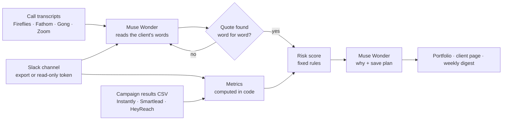

# Churn Radar

**See which agency clients are about to churn, weeks before the cancellation email. Churn Radar reads each client's Slack channel, call transcripts and campaign results, scores the risk with plain rules, and has Muse Wonder point to the exact sentences that worried it, plus a save plan for this week.**

Churn Radar runs on your own computer with your own keys. It is built for agencies and services-as-software teams where one operator runs many accounts: GTM engineering, outbound, paid media, content. You add a client, import its shared Slack channel, the transcripts of your calls and a CSV of campaign results. The app computes how results, engagement and the relationship are trending. Meta's **Muse Wonder** model reads only what the client said and returns evidence as exact quotes, which the code checks word for word. Then it writes why the account is at risk and three things to do this week.

It never sends anything to anyone. It answers one question every Monday: *which clients do we need to call first?*

> Churn Radar is an independent open-source project by Thought Pilot. It is not made by or affiliated with Frontal AI or ColdIQ.

---

## Contents
1. [Why it exists](#why-it-exists)
2. [How it works](#how-it-works)
3. [Features](#features)
4. [Quick start (5 minutes)](#quick-start)
5. [Connecting each source](#connecting-each-source)
6. [How the risk is computed](#how-the-risk-is-computed)
7. [Costs](#costs)
8. [Privacy and safety](#privacy-and-safety)
9. [Troubleshooting](#troubleshooting)
10. [Configuration reference](#configuration-reference)
11. [Project structure and development](#project-structure-and-development)
12. [Roadmap](#roadmap)

---

## Why it exists

Agencies rarely lose a client in one day. They lose them over six weeks of small signals nobody had time to connect. These are the problems Churn Radar was built to solve:

### 1. One operator, too many accounts
Services-as-software means one GTM engineer can now run 10 to 15 clients instead of 4. Delivery scales; attention doesn't. Nobody re-reads every client channel every week.

**What Churn Radar does:** it reads all of them every week and ranks the portfolio, most at risk first, with renewals that are coming up flagged as urgent.

### 2. Churn tools are built for SaaS, not services
Gainsight, Vitally and ChurnZero score product usage: logins, seats, features. An agency client has no product usage. Their signals are in Slack threads, call transcripts and the results you deliver.

**What Churn Radar does:** it uses the three sources an agency actually has: the shared Slack channel, call transcripts (Fireflies, Fathom, Gong, Zoom, Otter) and campaign results from any sequencer's CSV.

### 3. The warning was said out loud, then buried
"Leadership is asking if we should bring outbound in-house." "If October doesn't pick up we'll have to rethink the budget." These sentences get said on a call or dropped in a thread on a Friday, and they're gone by Monday.

**What Churn Radar does:** Muse Wonder reads what the client said and pulls out churn signals in six categories: unhappy with results, budget pressure, considering another agency or in-house, main contact changing, priorities shifting, and positive signals, so the picture stays fair.

### 4. AI that makes things up
A summary that says "the client seems frustrated" is useless if you can't see why, and dangerous if the model invented it.

**What Churn Radar does:** every piece of evidence is an exact quote, and the code checks that it appears word for word in the message or transcript it cites. Anything that doesn't is sent back once and then dropped and listed as "could not be checked". Every number in the save plan is also checked against the computed facts.

### 5. The quiet client
The most dangerous client isn't the one complaining. It's the one who stopped replying, or whose main contact went silent while a new name appeared in the channel.

**What Churn Radar does:** it measures client messages now vs the 28 days before, days since the client last wrote, typical reply time, whether the main contact has gone quiet, who is new on the client side, and days since the last call.

### 6. "We're behind on results" is a feeling, not a number
Account managers often know a month was weak but not by how much, or against what.

**What Churn Radar does:** meetings (or positive replies) in the last 28 days vs the 28 days before and vs the contract target, computed from your own export.

### At a glance

| Problem | What Churn Radar does |
|---|---|
| Too many accounts per operator | Ranks the whole portfolio every week, urgent renewals first |
| SaaS churn tools don't fit agencies | Slack, call transcripts and campaign results |
| Warnings buried in threads and calls | Muse Wonder extracts churn signals in 6 categories |
| AI that invents things | Exact quotes checked word for word; numbers checked against the facts |
| The quiet client | Message trend, silence, reply time, main contact, new voices, last call |
| Results as a feeling | Last 28 days vs before and vs the contract target |

---

## How it works



1. **Add a client:** name, your agency's email domain, the client's domain, the monthly fee, renewal date and target meetings.
2. **Import:** the Slack export (or read it with a read-only bot token), call transcripts, and a results CSV. Messages are sorted into "client" and "your team" by email domain, with teammates' names as a fallback.
3. **Measure:** results, engagement and relationship are computed in plain code over the last 28 days vs the 28 before.
4. **Read:** Muse Wonder gets only the client's side of the conversation from the last 90 days, newest first, with emails and phone numbers removed. It returns evidence with exact quotes.
5. **Verify:** each quote must appear word for word in the snippet it cites; otherwise it is retried once and then dropped.
6. **Score:** four areas get a colour by fixed rules, and a health score from 0 to 100.
7. **Plan:** Muse Wonder writes two sentences on what is going on and three actions for this week, with an owner and a deadline, plus questions for the next call. Every number in it is checked.
8. **Review:** the portfolio ranks every client; each analysis is kept, so the next one shows what changed; the weekly digest is markdown you can paste into your Monday meeting.

---

## Features

- **Slack export import** straight from the workspace ZIP (or the channel's day files), with the channel picked automatically when there is only one. Joins, bots and system messages are skipped; Slack markup becomes plain text.
- **Read-only Slack import** with a bot token: channel history, thread replies and user lookups only. No write scope is ever requested.
- **Transcripts** in WebVTT, SRT, plain text, Markdown, Otter style ("Name 0:12") and Fathom style ("0:12 - Name"), with the date read from the file name.
- **Campaign CSV** from any tool: common column names are recognised (sent, replies, positive or interested, meetings or booked), rows are summed into weeks, and day-first or month-first dates are detected per file.
- **Client vs team** detection by email domain (subdomains included), with teammates' names for sources without emails.
- **Risk areas with written rules:** Results, Engagement, Relationship and Conversations, each green, amber, red or unknown.
- **Exact-quote evidence** in six categories, verified in code.
- **Save plan:** three actions with owner and deadline, plus questions for the next call.
- **History:** every analysis is kept; "what changed since last time" on each client and in the digest.
- **Portfolio view**, most at risk first, with the sum of monthly fees at risk.
- **Weekly digest** as markdown, to copy yourself.
- **Works without Muse Wonder:** the metrics and three of the four areas don't need it.
- **Never sends anything:** no emails, no Slack messages, no posts.

---

## Quick start

You need **Node.js 22.13 or newer** (`node -v`).

```bash
git clone https://github.com/thoughtpilot99/muse-x-frontal.git
cd muse-x-frontal
npm install
npm run dev
```

Open http://localhost:3000 and follow the checklist on the home page:

1. **Setup:** paste your Muse Wonder key and press *Test*.
2. **Settings:** describe your agency in one or two sentences.
3. **Add client:** fill in the domains, fee, renewal date and target.
4. On the client's page, import **Slack**, **calls** and **results**, then press **Analyse**.

For an always-on install use `npm run build && npm start`. Analyse all clients from the home page once a week (Monday morning works well).

---

## Connecting each source

### Muse Wonder (reads the conversations)
Create a key at [dev.meta.ai](https://dev.meta.ai) → API keys, and paste it on **Setup**. The model is `muse-wonder-1.0` on Meta's OpenAI-compatible API.

### Slack
- **Export (no setup):** an admin exports the workspace (Slack → Settings & administration → Import/export data). Upload the ZIP on the client's page. If the export has several channels, type the shared channel's name. You can also upload just that channel's folder of day files plus `users.json`.
- **Read-only token (optional):** create an app at [api.slack.com/apps](https://api.slack.com/apps) with the bot scopes `channels:history`, `groups:history`, `users:read` and `users:read.email`. Install it, invite it to the client channel, paste the `xoxb-` token on **Setup**, and put the channel ID (starts with `C`) on the client.

Slack Connect channels work: anyone with an email outside your domains is treated as the client's side.

### Call transcripts
Export from Fireflies, Fathom, Gong, Zoom, Otter or Google Meet as `.txt`, `.vtt`, `.srt` or `.md`. Put the date in the file name (`2026-10-01-weekly-sync.vtt`) or fill in the date field. Add your teammates' names on the client so only the client's words are read.

### Campaign results
Any CSV with a date column and at least one of: meetings booked, positive replies or replies (sent is optional). For example, an Instantly or Smartlead daily analytics export, a HeyReach export, or a sheet you keep by hand.

---

## How the risk is computed

Windows are the **last 28 days** and the **28 days before**. Unknown areas are left out of the score and never count as risk.

| Area | Weight | Green | Amber | Red |
|---|---|---|---|---|
| **Results** | 30% | Meetings at least 80% of the target (or of the 28 days before) | 50-80% | Under 50%, or none in 56 days |
| **Engagement** | 25% | Client messages at least 70% of before, and the client wrote in the last 10 days | 40-70%, or silent for 11-21 days | Under 40%, or silent for over 21 days |
| **Relationship** | 15% | The main contact still writes at their usual rate; a call in the last 45 days | Main contact at under half their usual rate, or no call in 45 days | Main contact silent for 28 days |
| **Conversations** | 30% | No warning signs in the last 45 days | One warning (complaint, budget or a priority shift) | Main contact changing, another agency or in-house mentioned, or 2+ complaints or budget warnings |

- **Health** is the weighted average of the known areas (green 100, amber 50, red 0). Under 50% of the weight known means "Not enough data".
- **Status:** 75 or more is Healthy, 50-74 Watch, under 50 At risk.
- **Urgent:** not Healthy and the renewal is within 45 days.
- **Main contact** is the client-side person with the most messages in the 62 days before the last 28 (at least 3).
- Results use meetings when the export has them, otherwise positive replies. Data must reach into the last 14 days, so a stale export shows as unknown instead of as a bad month.

All of this is in `lib/metrics.ts` and `lib/risk.ts`, covered by tests. The day thresholds are editable in **Settings**.

---

## Costs

**Muse Wonder** list price is $4 per million input tokens and $20 per million output tokens. One client analysis reads up to about 40,000 characters of client messages and transcripts and makes two calls (three or four with retries), so it costs a few cents. Total spend is on the home page and per step on **Events**.

Nothing else costs money: Slack exports, the read-only Slack API and CSV imports are free.

---

## Privacy and safety

- **Client data stays on your computer**, in `data/app.db` (gitignored).
- **Only client-side excerpts go to Muse Wonder:** messages and transcript lines from the client's side, from the last 90 days, with emails, phone numbers and key-like strings removed first. Your team's messages are not sent.
- **Nothing is ever sent to clients or anyone else.** There is no email, Slack posting or social posting in the code, and the Slack integration only uses read methods.
- **Delete anytime:** remove a client's Slack data, calls or results, or the whole client, from its page.
- Set `APP_PASSWORD` before exposing the app beyond your own computer. See [SECURITY.md](SECURITY.md).

---

## Troubleshooting

| Symptom | Fix |
|---|---|
| "This export has N channels" | Type the shared channel's name in the box next to the upload |
| Many messages are "unknown" | Add your agency's email domain and teammates' names on the client, then save (messages are re-sorted) |
| Results show "unknown" | The CSV needs dates reaching into the last 14 days; upload a recent export |
| "No date found" for a transcript | Put the date in the file name (`2026-10-01-call.vtt`) or use the date field |
| A quote is listed as "could not be checked" | Muse Wonder paraphrased it; it was left out of the score on purpose |
| Conversations is "unknown" | Connect Muse Wonder on Setup and import Slack or calls |
| Slack import says `missing_scope` | Add the read scopes listed under Connecting each source, reinstall the app |

---

## Configuration reference

All optional; keys can also be entered on **Setup**.

| Variable | Purpose |
|---|---|
| `MODEL_API_KEY` | Muse Wonder (Meta Model API) key |
| `SLACK_BOT_TOKEN` | Optional read-only Slack bot token |
| `APP_PASSWORD` | Password for the whole UI (any username) |
| `MUSE_BASE_URL` | Default `https://api.meta.ai/v1` |
| `MUSE_MODEL` | Default `muse-wonder-1.0` |
| `CR_DB_PATH` | Database file, default `data/app.db` |

---

## Project structure and development

```
app/
  page.tsx                 Portfolio, most at risk first
  clients/new/             Add a client
  clients/[id]/            Imports, risk areas, quotes, save plan, history
  digest/                  Weekly digest (markdown)
  setup/ settings/ events/ Keys, rules, Muse Wonder costs and errors
lib/
  sources/slack.ts         Export parser, read-only API, client vs team
  sources/transcripts.ts   VTT, SRT, text, Otter and Fathom formats
  sources/campaigns.ts     Any sequencer CSV, summed into weeks
  sources/zip.ts           Minimal ZIP reader for Slack exports
  metrics.ts               Results, engagement, relationship (pure)
  risk.ts                  The rules and the health score (pure)
  agents.ts                Snippets, exact-quote evidence, save plan, number checks
  accounts.ts              Imports, analysis runs, portfolio, digest
  redact.ts                Emails, phone numbers and keys removed before Muse
  muse.ts db.ts secrets.ts settings.ts config.ts csv.ts
tests/                     Vitest, on a fictional account (tests/fixtures.ts)
```

```bash
npm test             # vitest
npm run lint
npx next typegen && npx tsc --noEmit
npm run build
```

The test account, "Acme Robotics" on `acme.example`, is **fictional**: the names, messages and numbers are made up to match the shape of real exports. Nothing in this repository comes from a real client.

---

## Roadmap

- Direct Instantly, Smartlead and HeyReach API imports (CSV works today)
- Fireflies and Fathom API imports
- Scheduled weekly analysis
- Per-client trend chart across analyses

---

## License

MIT. See [LICENSE](LICENSE).
